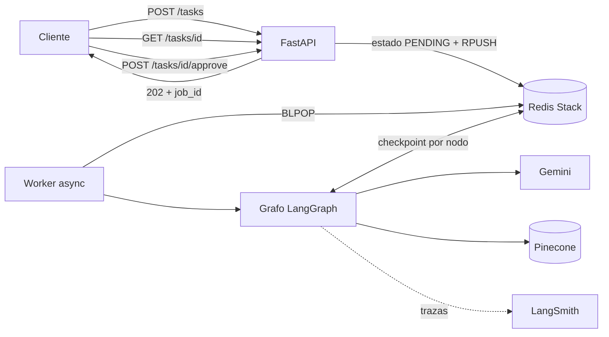
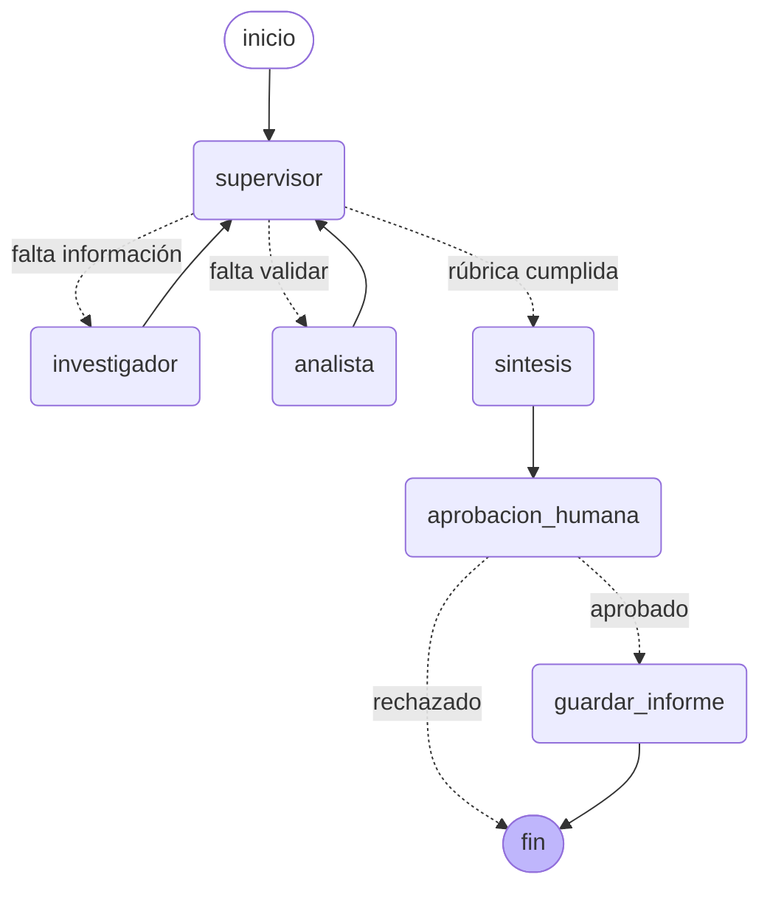
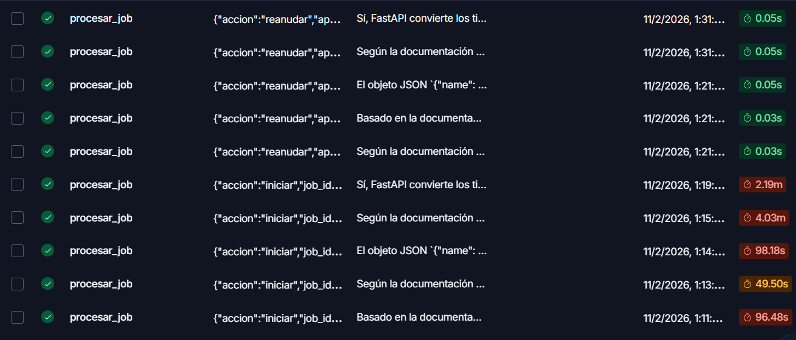
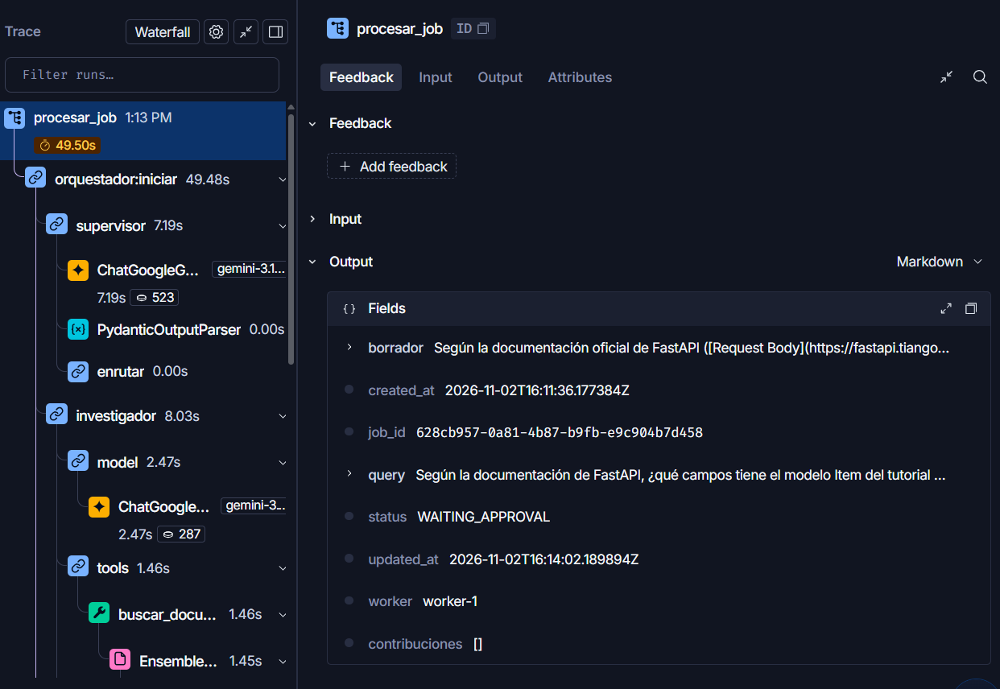
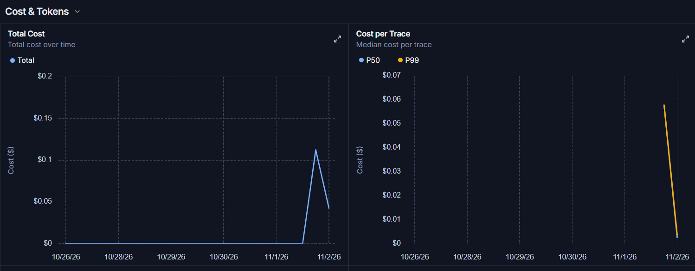
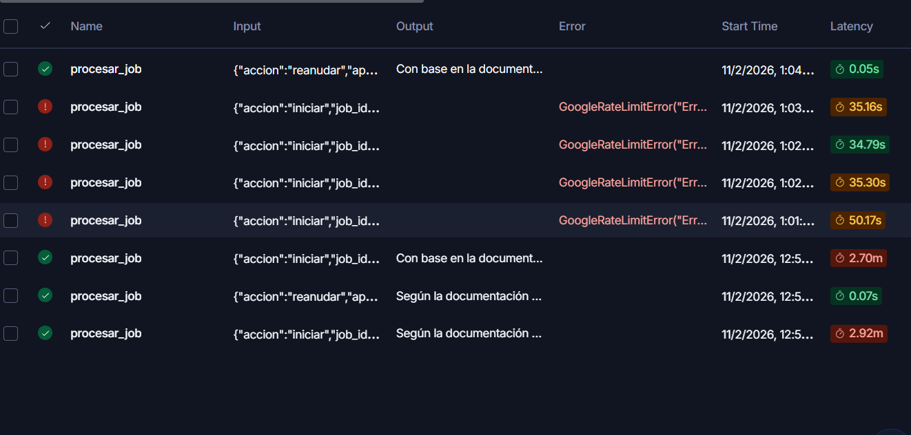

# Orquestador multi-agente con RAG, HITL y observabilidad

API asíncrona que responde consultas técnicas sobre FastAPI combinando dos especialistas: un **investigador** que busca en la documentación (RAG híbrido BM25 + Pinecone) y un **analista** que valida datos JSON contra el esquema encontrado. Un **supervisor** (LangGraph) decide quién trabaja en cada paso y valida los resultados con una rúbrica. Antes de la única acción con efecto secundario (guardar el informe), el grafo se pausa hasta recibir aprobación humana.

Las consultas no bloquean la API: se encolan en Redis, un worker las procesa en segundo plano y el estado del grafo se guarda después de cada nodo, así que un reinicio del servidor no pierde trabajo. Cada ejecución queda trazada en LangSmith, con su árbol de pasos, tokens y costo.

Proyecto final — AI Engineering (Coderhouse).

## Arquitectura



### Grafo de agentes



| Nodo | Responsabilidad | Herramienta |
|---|---|---|
| `supervisor` | Elige el próximo especialista (salida estructurada con `Literal`) y aplica una rúbrica: datos con fuente, todos los JSON validados, consistencia y suficiencia. Corta al llegar a `MAX_PASOS`. | — |
| `investigador` | Busca en la documentación de FastAPI. | `buscar_documentacion_fastapi` (RAG híbrido) |
| `analista` | Valida JSON contra el esquema que encontró el investigador. | `validar_json_contra_esquema` (Pydantic) |
| `sintesis` | Redacta la respuesta final solo con los aportes del equipo. | — |
| `aprobacion_humana` | `interrupt()`: pausa el grafo y expone el borrador. | — |
| `guardar_informe` | Escribe el informe en disco. Única acción con efecto secundario. | — |

### Estados de un job

```
PENDING → RUNNING → WAITING_APPROVAL → (approve) → PENDING → RUNNING → DONE
              └──────────── excepción en cualquier punto ────────────▶ FAILED
```

## Estructura

El repo integra las capas de todo el curso:

| Carpeta | Capa | Origen |
|---|---|---|
| `app/core/` | Configuración validada (`pydantic-settings`) y cliente async del LLM con rate limiter | Módulos 1 y 2 |
| `app/rag/` | Recuperador híbrido BM25 + Pinecone | Módulos 3 y 4 |
| `app/agents/` | Supervisor, investigador, analista y síntesis | Módulos 5 y 6 |
| `app/graph/` | Estado compartido, construcción del grafo y nodos HITL | Módulos 6 y 7 |
| `app/services/` | Estado de jobs y cola en Redis, worker | Módulo 7 |
| `app/api/` | Endpoints y contratos Pydantic | Módulo 7 |
| `app/observability/` | Configuración de LangSmith | Módulo 7 |
| `scripts/` | Bootstrap de Pinecone, ingesta y prueba de punta a punta | — |
| `data/` | Documentación de FastAPI (8 páginas) y `chunks.json` para BM25 | Módulo 4 |

## Decisiones técnicas

### Async de punta a punta, threads solo para CPU

Toda la comunicación externa es asíncrona: Gemini usa el cliente `aio` del SDK de Google, Pinecone el cliente `PineconeAsyncio` y Redis `redis.asyncio`. El `EnsembleRetriever` en modo async ejecuta BM25 y Pinecone en paralelo.

Lo que no es I/O sino cálculo (BM25, el embedding de la pregunta, cargar el modelo al arrancar, escribir el informe) corre en un thread (`asyncio.to_thread` / `run_in_executor`). No existe una versión "async" del cálculo, y en un thread no bloquea el event loop.

Para verificarlo, `ASYNC_DEBUG=true` activa el modo debug de asyncio, que registra cualquier tarea que ocupe el event loop más de 100 ms. Con el flujo completo no aparece ningún aviso; con un `time.sleep` agregado a propósito en una herramienta, lo detecta y señala la herramienta.

### La API nunca espera al agente

`POST /tasks` guarda el estado, encola y responde `202` con el `job_id`. Un worker consume la cola con `BLPOP` y el cliente consulta el estado con `GET /tasks/{id}`. Las aprobaciones y los jobs que se retoman entran al **principio** de la cola (`LPUSH`): reanudar tarda menos de 0,1 s y no tiene sentido que espere detrás de consultas nuevas.

### Persistencia: nada se pierde al reiniciar

Redis cumple dos funciones: el estado de los jobs y la cola, por un lado, y los checkpoints de LangGraph (`AsyncRedisSaver`), por otro. El grafo guarda su estado después de cada nodo, con `thread_id = job_id`.

- **Apagado ordenado con un job en curso:** el worker lo vuelve a encolar y, al reiniciar, LangGraph continúa desde el último nodo guardado (`ainvoke(None, config)`) sin repetir los que ya terminaron.
- **Corte brusco:** al arrancar, los jobs que quedaron en `RUNNING` se detectan y se vuelven a encolar.
- **Pausa del HITL:** el job sigue esperando aprobación después de un reinicio.
- `GET /tasks/{id}/conversation` lee la conversación directamente del checkpointer, lo que permite comprobar la persistencia.

`AsyncRedisSaver` necesita los módulos de búsqueda y JSON, por eso se usa **Redis Stack** y no la imagen común de Redis.

### Contratos Pydantic en cada frontera

| Frontera | Modelo |
|---|---|
| Entrada de la API | `TaskRequest` (3 a 2000 caracteres), `AprobacionRequest` |
| Salida de la API | `response_model` en todos los endpoints |
| Redis | `Job` (estado) y `MensajeCola` (cola): un dato corrupto falla al leerse |
| Herramientas | `args_schema` de entrada y JSON validado de salida. El esquema del analista solo acepta los tipos `str`, `int`, `float` y `bool` (`Literal`, sin `eval`): si el LLM manda otro, Pydantic lo rechaza y el LLM recibe el error para corregirse |
| Supervisor | Salida estructurada `DecisionSupervisor` |
| Configuración | `Settings`: si falta una variable o una key está vacía, la app no arranca |

### Human-in-the-loop

Guardar el informe es la única acción con efecto secundario, así que siempre requiere aprobación. `interrupt()` deja el grafo pausado en Redis, y el endpoint `/approve` encola la reanudación con `Command(resume=...)`. Como LangGraph re-ejecuta el nodo al reanudar, no hay efectos secundarios antes del `interrupt()`.

### Límites del LLM y elección del modelo

El plan gratuito de Gemini limita pedidos por minuto y por día, por modelo. Con `gemini-3.6-flash` (5 por minuto, 20 por día) solo entraban unas 2 consultas diarias, porque cada una hace unas 8 llamadas. Se cambió a `gemini-3.1-flash-lite` (15 por minuto) **solo editando el `.env`**, sin tocar código.

Para no chocar contra el límite por minuto, el LLM usa un `InMemoryRateLimiter` compartido por todos los nodos (`LLM_RPM`): las llamadas esperan su turno en vez de fallar con `429`. Con este límite se usa un solo worker (`WORKERS=1`): el tiempo total es el mismo y cada job termina antes.

### Sin valores hardcodeados

Modelos, índice, namespace y URLs salen del `.env` (ver `.env.example`). El código no tiene ningún ID ni nombre de modelo escrito.

## Cómo levantarlo

Requisitos: Docker y tres API keys gratuitas: [Gemini](https://aistudio.google.com/apikey), [Pinecone](https://app.pinecone.io) y [LangSmith](https://smith.langchain.com).

```bash
cp .env.example .env      # completar GOOGLE_API_KEY, PINECONE_API_KEY y LANGSMITH_API_KEY
docker compose up --build
```

Ese único comando levanta Redis Stack y la API. Al arrancar, `scripts/bootstrap.py` crea el índice de Pinecone y carga la documentación si todavía no existen; si ya están, no hace nada. La API queda en `http://localhost:8000/docs`.

<details>
<summary>Sin Docker para la API (desarrollo)</summary>

```bash
docker compose up -d redis
python -m venv .venv
source .venv/bin/activate        # Windows (Git Bash): source .venv/Scripts/activate
pip install -e .
python -m scripts.bootstrap
uvicorn app.main:app
```
</details>

## Uso

| Método | Ruta | Qué hace |
|---|---|---|
| `POST` | `/tasks` | Encola una consulta y devuelve `job_id` (`202`) |
| `GET` | `/tasks/{job_id}` | Estado del job: borrador, resultado o error |
| `GET` | `/tasks/{job_id}/conversation` | Mensajes y aportes de cada agente, leídos del checkpointer |
| `POST` | `/tasks/{job_id}/approve` | `{"aprobado": true}` guarda el informe; `false` lo descarta |
| `GET` | `/health` | Verifica la conexión con Redis |

Ejemplo de consulta:

```json
{"query": "Según la documentación de FastAPI, ¿qué campos tiene el modelo Item del tutorial de Request Body? Validá si {\"name\": \"Teclado\", \"price\": 45.2} es válido."}
```

Prueba de punta a punta, con 5 consultas concurrentes que se aprueban automáticamente:

```bash
python scripts/prueba_carga.py --aprobar
```

## Observabilidad: 5 pruebas de punta a punta

Con `LANGSMITH_TRACING=true`, LangChain y LangGraph envían cada nodo, llamada al LLM, herramienta y retriever. `procesar_job` está decorada con `@traceable`, así que cada job es una traza con todo el grafo adentro, etiquetada con su `job_id` y la acción (`iniciar` o `reanudar`).

### Las 5 ejecuciones

Cada prueba genera dos trazas: `iniciar` (hasta la pausa) y `reanudar` (después de la aprobación). Las 10 terminaron bien.



| Traza | Latencia |
|---|---|
| `iniciar` (supervisor → investigador → analista → síntesis) | 49,5 s a 4,03 min |
| `reanudar` (retoma el checkpoint y guarda el informe) | 0,03 s a 0,05 s |

### Árbol de spans

Cada ejecución muestra la jerarquía completa, con modelo, tokens y tiempo de cada paso.



En la traza de ejemplo, la decisión del supervisor tomó 7,2 s (523 tokens) y el investigador 8,0 s, de los cuales la búsqueda híbrida tardó 1,5 s y el resto fueron llamadas al LLM.

### Costo por ejecución



### Lectura

- **La latencia está en el LLM.** La búsqueda híbrida tarda alrededor de 1,5 s y reanudar desde el checkpoint menos de 0,1 s; los minutos de cada ejecución son llamadas a Gemini, más la espera del rate limiter del plan gratuito.
- **El costo por ejecución es de centavos de dólar**, como muestra el gráfico de costo por traza.
- **Manejo de errores:** en una corrida anterior con `gemini-3.6-flash`, 4 jobs superaron la cuota diaria. El worker capturó la excepción y los dejó en `FAILED` con el motivo, en lugar de dejarlos colgados.



## Limitaciones y próximos pasos

- Con el plan gratuito de Gemini, el rate limiter hace que cada consulta tarde minutos. Con un plan pago basta con subir `LLM_RPM` y `WORKERS`.
- El rate limiter vive en memoria del proceso: con varias réplicas de la API habría que moverlo a Redis.
- El supervisor recibe todas las contribuciones completas en cada vuelta; resumirlas reduciría los tokens de entrada.
